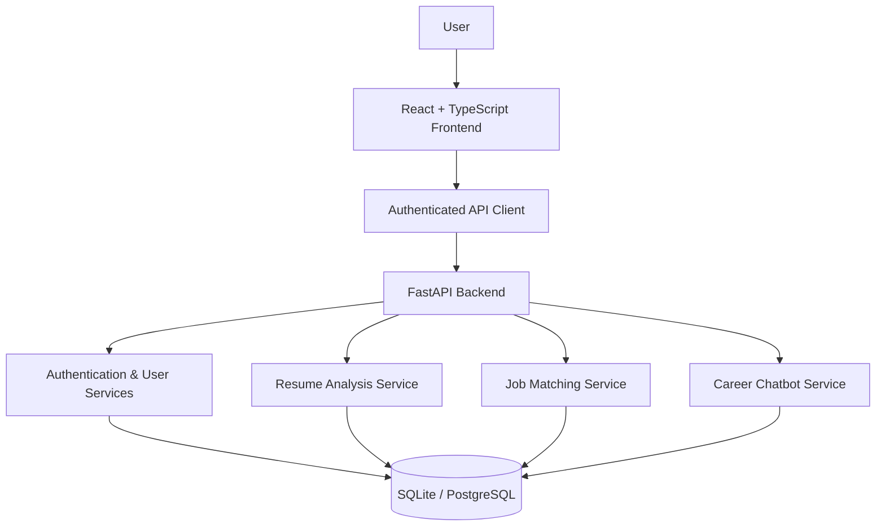

# SmartHire AI — Career Intelligence, Reimagined

<p align="center">
  
</p>

<p align="center">
  <strong>An AI-powered career intelligence workspace built to help job seekers understand their resumes, identify skill gaps, and make smarter career decisions.</strong>
</p>

<p align="center">
  <a href="https://github.com/SyedRaqi/Resume-analyzer"></a>
  
  
  
</p>

<p align="center">
  <a href="#-the-vision">The Vision</a> •
  <a href="#-core-capabilities">Features</a> •
  <a href="#-technology-stack">Tech Stack</a> •
  <a href="#-get-started">Get Started</a> •
  <a href="#-api-overview">API</a>
</p>

---

## ✦ The Vision

**Your resume tells your story. SmartHire AI helps you make it stronger.**

The job market is competitive. Job seekers need more than a resume template or a single matching percentage — they need meaningful feedback, a clearer understanding of their strengths, and practical guidance on what to improve.

SmartHire AI brings resume intelligence, job-description matching, skill-gap analysis, and conversational career guidance together in one full-stack application.

Instead of treating career preparation as a guessing game, SmartHire AI turns it into a more structured, understandable process.

> **Understand your profile. Discover your gaps. Prepare for your next opportunity.**

## ◈ Core Capabilities

<table>
  <tr>
    <td width="50%" valign="top">
      <h3>📄 Resume Intelligence</h3>
      Extract text from PDF resumes and evaluate skills, education, projects, experience, and document structure using explainable scoring.
    </td>
    <td width="50%" valign="top">
      <h3>🎯 Job Description Matching</h3>
      Compare a resume with a job description using skill coverage and TF-IDF cosine similarity to produce a matching assessment.
    </td>
  </tr>
  <tr>
    <td width="50%" valign="top">
      <h3>🧩 Skill-Gap Detection</h3>
      Identify skills present in a resume, highlight missing requirements, and help users prioritize areas for improvement.
    </td>
    <td width="50%" valign="top">
      <h3>🤖 AI Career Assistant</h3>
      Get contextual career guidance through an assistant that supports OpenAI integration and a local fallback for common questions.
    </td>
  </tr>
  <tr>
    <td width="50%" valign="top">
      <h3>🔐 Secure User Workspace</h3>
      Support registration, authentication, protected API operations, and user-specific resume and chat workflows.
    </td>
    <td width="50%" valign="top">
      <h3>📈 Career Progress Tools</h3>
      Review resume analyses, revisit job-match history, update profile information, and work on improvements through a responsive interface.
    </td>
  </tr>
</table>

## ⌁ How It Works

<p align="center">
  
  
  
  
</p>

1. **Upload:** Provide a supported PDF resume.
2. **Analyze:** Extract resume text and review the component-based assessment.
3. **Compare:** Paste a job description to identify matching and missing skills.
4. **Improve:** Use the results and career assistant to plan practical next steps.

---

## ⚙️ Technology Stack

| Layer | Technologies |
|---|---|
| Frontend | React, TypeScript, Vite, React Router |
| UI | Custom responsive CSS, Lucide React |
| Backend | Python, FastAPI, Pydantic |
| Data access | SQLAlchemy |
| Local database | SQLite |
| Production database option | PostgreSQL |
| Resume processing | PyMuPDF |
| Matching | TF-IDF, cosine similarity, skill-overlap scoring |
| Authentication | JWT-based authentication |
| AI assistant | Optional OpenAI API integration with local fallback |
| Deployment support | Docker Compose configuration for PostgreSQL |

## 🏗️ Architecture



### Project Structure

```text
Resume-analyzer/
├── backend/
│   ├── app/
│   │   ├── main.py
│   │   ├── database.py
│   │   ├── models.py
│   │   ├── schemas.py
│   │   ├── deps.py
│   │   └── services/
│   │       ├── resume_service.py
│   │       └── chatbot_service.py
│   ├── requirements.txt
│   └── .env.example
├── frontend/
│   ├── src/
│   │   ├── App.tsx
│   │   ├── styles.css
│   │   ├── lib/
│   │   │   └── api.ts
│   │   └── components/
│   │       └── Logo.tsx
│   └── .env.example
├── uploads/
├── docker-compose.yml
└── README.md
```

*The tree above highlights the main files documented for the project; additional files and routes may exist in the repository.*

## 🚀 Get Started

Run SmartHire AI locally on Windows using PowerShell.

### Prerequisites

- Python 3.11 or later
- Node.js 20 or later
- npm 10 or later
- Git

### 1. Clone the repository

```powershell
git clone https://github.com/SyedRaqi/Resume-analyzer.git
cd Resume-analyzer
```

### 2. Configure the backend

```powershell
cd backend

py -3.11 -m venv .venv
.\.venv\Scripts\Activate.ps1

python -m pip install --upgrade pip
pip install -r requirements.txt

Copy-Item .env.example .env
```

Open `backend/.env` and configure the required settings. SQLite is the default for local development; configure `DATABASE_URL` if you intend to use PostgreSQL.

Start the API:

```powershell
python -m uvicorn app.main:app --host 127.0.0.1 --reload --port 8000
```

Once the server starts, open:

- API documentation: http://localhost:8000/docs
- API root: http://localhost:8000/

### 3. Configure the frontend

Open a **second PowerShell terminal** from the repository root:

```powershell
cd frontend

npm install

Copy-Item .env.example .env

npm run dev
```

Open the local URL printed by Vite, normally:

http://localhost:5173

If your frontend environment file requires an API base URL, set it to your locally running backend using the exact variable name documented in `frontend/.env.example`.

### 4. Enable the AI assistant (optional)

Add your own API key to `backend/.env`:

```dotenv
OPENAI_API_KEY=your-api-key
OPENAI_MODEL=gpt-4o-mini
```

Restart the backend after changing environment variables.

**Security:** Keep API keys in environment variables on the backend. Never commit `.env` files, production credentials, or private tokens to GitHub.

Without an API key, the application can use its documented local fallback for supported common career questions.

### 5. Optional PostgreSQL setup

If you want to run PostgreSQL through the supplied Docker Compose configuration:

```powershell
docker compose up -d postgres
```

Configure `DATABASE_URL` in `backend/.env` using the connection details defined by your Compose configuration. Install the PostgreSQL driver specified by your backend dependencies if required.

---

## 🧠 Matching & Scoring Methodology

SmartHire AI uses transparent, rule-based and text-similarity techniques to help users understand their results.

| Component | Approach |
|---|---|
| Resume extraction | PyMuPDF-based PDF text extraction |
| Resume assessment | Component scores for skills, education, projects, experience, and structure |
| Skill matching | Case-insensitive matching against a curated skill vocabulary |
| Job similarity | TF-IDF vectorization and cosine similarity |
| Overall job-match score | Weighted combination of skill coverage (65%) and text similarity (35%) |
| Career chat | Optional LLM integration with deterministic fallback guidance |

The resume assessment combines component scores into an overall coaching score. The job-match calculation keeps skill coverage and text similarity as separate components.

**Important:** These scores are coaching indicators, not official ATS scores, hiring decisions, or guarantees of interview selection. Results depend on resume quality, extracted text, and the supplied job description.

## 🔌 API Overview

The backend exposes REST endpoints for the following workflows.

| Feature | Method | Endpoint |
|---|---|---|
| Registration | POST | `/api/auth/register` |
| Login | POST | `/api/auth/login` |
| Current user | GET | `/api/auth/me` |
| Logout | POST | `/api/auth/logout` |
| Request password reset | POST | `/api/auth/forgot-password` |
| Reset password | POST | `/api/auth/reset-password` |
| Upload resume | POST | `/api/resumes/upload` |
| List resumes | GET | `/api/resumes` |
| Delete resume | DELETE | `/api/resumes/{id}` |
| Analyze resume | POST | `/api/resumes/{id}/analyze` |
| Retrieve analysis | GET | `/api/resumes/{id}/analysis` |
| Match job description | POST | `/api/jobs/match` |
| Job-match history | GET | `/api/jobs/history` |
| Send chat message | POST | `/api/chat` |
| List conversations | GET | `/api/chat/conversations` |
| Retrieve conversation | GET | `/api/chat/conversations/{id}` |
| User profile | GET / PUT | `/api/users/profile` |

Use the interactive API documentation at `/docs` to inspect request bodies, authentication requirements, and response formats.

## 🧪 Testing & Verification

Run the backend syntax check from the repository root:

```powershell
python -m compileall backend\app
```

Build and type-check the frontend:

```powershell
cd frontend
npm run build
```

### Suggested end-to-end test

- [ ] Register a new account and sign in.
- [ ] Upload a text-based PDF resume.
- [ ] Open the generated resume analysis.
- [ ] Review component scores and improvement suggestions.
- [ ] Paste a job description and run a match.
- [ ] Review matching and missing skills.
- [ ] Update the user profile.
- [ ] Test the career assistant with and without an OpenAI key.
- [ ] Verify that protected endpoints require authentication.
- [ ] Test password-reset flows and configure an email provider before production use.
- [ ] Verify that one user's private records cannot be accessed by another user.

## 🔒 Security & Production Considerations

Before deploying a public instance:

- Keep API secrets and database credentials out of source control.
- Restrict access to private resume files and user-specific records.
- Validate file types, file sizes, and uploaded content.
- Configure production CORS origins and HTTPS.
- Use secure token handling and appropriate token expiration.
- Configure a real email provider for password-reset delivery.
- Use persistent production database and file storage.
- Add rate limiting, structured logging, backups, and error monitoring.
- Review the application's authentication, authorization, and data-retention policies.

For production deployment, PostgreSQL is a more suitable default than an ephemeral SQLite file on many hosting platforms. Uploaded files and other persistent user data also need durable storage.

## 🛣️ Future Roadmap

- [ ] Versioned skills taxonomy and semantic embeddings
- [ ] More advanced resume-improvement recommendations
- [ ] Human-reviewed suggestions and improved PDF export
- [ ] Integration with curated job listing sources
- [ ] Background processing for resume analysis
- [ ] Persistent object storage and file lifecycle management
- [ ] Automated test coverage and CI/CD
- [ ] Production observability and deployment hardening

## 🎓 Built as a Full-Stack AI Project

SmartHire AI brings together frontend engineering, API development, database design, authentication, natural-language processing, text similarity, and practical AI integration.

It is designed to demonstrate how an AI-assisted career product can be built around understandable results rather than a single unexplained score.

---

<p align="center">
  <strong>Build your skills. Strengthen your story. Move forward with confidence.</strong>
</p>

<p align="center">
  <a href="https://github.com/SyedRaqi/Resume-analyzer"><strong>Explore the Repository →</strong></a>
</p>

<p align="center">
  <sub>Created by <a href="https://github.com/SyedRaqi">Syed Raqi</a> · SmartHire AI</sub>
</p>
