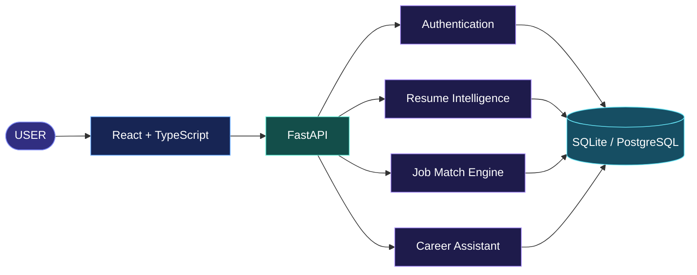

<!-- SMART HIRE AI | CINEMATIC README -->

<div align="center">


<br/>

# SmartHire AI

### CAREER INTELLIGENCE. REENGINEERED.

**Your potential is greater than a resume. Discover what makes you stand out.**

An AI-powered career workspace for resume intelligence, skill-gap discovery, job matching, and smarter career preparation.

<br/>

<a href="https://github.com/SyedRaqi/Resume-analyzer">
  
</a>
&nbsp;
<a href="#features">
  
</a>

<br/><br/>


</div>

---

<a id="vision"></a>

## ◉  THE VISION

The next opportunity shouldn't depend on guesswork.

SmartHire AI transforms career preparation into a structured, data-informed process. It helps users understand their resume, compare their skills with job requirements, identify gaps, and get practical guidance.

**Upload. Understand. Improve. Advance.**

<a id="features"></a>

## ◈  INTELLIGENCE MODULES

<table>
<tr>
<td width="50%" valign="top">

### 01 / Resume Intelligence

Extract and analyze resume content, with component-based assessments covering skills, education, projects, experience, and structure.

</td>
<td width="50%" valign="top">

### 02 / Job Match Engine

Compare resumes with job descriptions using skill coverage and TF-IDF cosine similarity.

</td>
</tr>
<tr>
<td width="50%" valign="top">

### 03 / Skill-Gap Discovery

Identify matching and missing skills to help users understand where additional preparation may be valuable.

</td>
<td width="50%" valign="top">

### 04 / AI Career Assistant

Get career guidance through optional OpenAI integration, with a local fallback for supported common questions.

</td>
</tr>
<tr>
<td width="50%" valign="top">

### 05 / Personal Workspace

Manage accounts, resumes, analysis history, job matches, conversations, and profile information.

</td>
<td width="50%" valign="top">

### 06 / Explainable Results

Keep resume assessment components and job-matching signals visible instead of presenting every result as an unexplained number.

</td>
</tr>
</table>

---

## ⌬  THE EXPERIENCE

<div align="center">

| PHASE | ACTION | OUTCOME |
|:---:|---|---|
| 01 | Upload your resume | Extracted resume content |
| 02 | Analyze your profile | Component-based feedback |
| 03 | Compare a job description | Matching and missing skills |
| 04 | Explore your next steps | More focused career preparation |

</div>

## ⟁  UNDER THE HOOD



### TECHNOLOGY MATRIX

| SYSTEM | TECHNOLOGY |
|---|---|
| Interface | React, TypeScript, Vite, React Router |
| Visual layer | Responsive CSS, Lucide React |
| API layer | Python, FastAPI, Pydantic |
| Persistence | SQLAlchemy, SQLite, PostgreSQL option |
| Document processing | PyMuPDF |
| Matching algorithms | TF-IDF, cosine similarity, skill overlap |
| Security | JWT-based authentication |
| Conversational AI | Optional OpenAI integration and local fallback |

---

## ⌘  RUN IT LOCALLY

### Requirements

- Python 3.11+
- Node.js 20+
- npm 10+
- Git

### 01 — Clone

```powershell
git clone https://github.com/SyedRaqi/Resume-analyzer.git
cd Resume-analyzer
```

### 02 — Start the backend

```powershell
cd backend
py -3.11 -m venv .venv
.\.venv\Scripts\Activate.ps1
pip install -r requirements.txt
Copy-Item .env.example .env
python -m uvicorn app.main:app --reload --port 8000
```

API documentation: http://localhost:8000/docs

### 03 — Start the frontend

Open a second terminal from the project root:

```powershell
cd frontend
npm install
Copy-Item .env.example .env
npm run dev
```

Open the local URL printed by Vite, usually http://localhost:5173.

Configure any required API base URL using the variable documented in `frontend/.env.example`.

### 04 — Optional AI configuration

Add your own API key to `backend/.env` if you want to enable the OpenAI-backed assistant:

```dotenv
OPENAI_API_KEY=your-api-key
OPENAI_MODEL=gpt-4o-mini
```

Never commit secrets or `.env` files to GitHub.

---

## ◈  MATCHING METHODOLOGY

| COMPONENT | APPROACH |
|---|---|
| Resume extraction | PDF text extraction with PyMuPDF |
| Resume assessment | Component scores combined into an overall coaching score |
| Skill detection | Curated vocabulary and case-insensitive matching |
| Job similarity | TF-IDF vectorization and cosine similarity |
| Job-match calculation | 65% skill coverage + 35% text similarity |
| Career guidance | Optional LLM integration or deterministic fallback |

These scores are coaching signals, not official ATS scores or guarantees of hiring outcomes.

## ⛨  ENGINEERING & SECURITY

- JWT-based authentication and protected API workflows
- User-specific resume and conversation operations
- Environment-based configuration for secrets
- SQLite for local development and a PostgreSQL option
- PDF upload and processing workflow

Before production deployment, verify file validation, access controls, persistent storage, CORS, token handling, rate limiting, and email delivery for password resets.

## ⌁  ROADMAP

- [ ] Semantic skill matching with embeddings
- [ ] Enhanced resume-improvement recommendations
- [ ] Curated job-source integration
- [ ] Background processing and durable file storage
- [ ] Automated tests and continuous integration
- [ ] Production monitoring and deployment hardening

---

<div align="center">


### ENGINEER YOUR NEXT OPPORTUNITY.

**SmartHire AI** · Built by [Syed Raqi](https://github.com/SyedRaqi)

<a href="https://github.com/SyedRaqi/Resume-analyzer">SOURCE CODE</a>

<sub>Understand your profile. Discover your potential. Keep moving forward.</sub>

</div>
